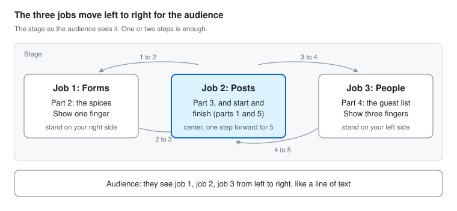

# Writing a Speech with Purpose: Give AI a Job

By Azizjon Kasimov · Daejeon Toastmasters · prepared Oct 27, 2026

Phone version of the script: [give-ai-a-job-phone-script.pdf](give-ai-a-job-phone-script.pdf)

## At a glance

Your speech is on Saturday, Nov 7, 2026. It must run 5 to 7 minutes, so aim for 6:00.

| What | Details |
| --- | --- |
| Title | Give AI a Job |
| Project | Writing a Speech with Purpose, Level 1, Presentation Mastery |
| Time | 5 to 7 minutes. The timer shows green at 5:00, yellow at 6:00, red at 7:00 |
| Your target | 6:00, about 680 words at a calm pace |
| General purpose | To inform |
| Specific purpose | After my speech, the audience will know three simple ways to use AI in daily life: filling in hard forms, posting in many places at once, and getting ready to meet people. |
| Main message | AI is great at boring jobs. Let it do the clicking, so you have more time for people. |
| Structure | Topical: three jobs. Each job has one real story and one rule |
| What the evaluator scores | Clarity, vocal variety, eye contact, gestures, interest and purpose, comfort level, specific purpose, general purpose. See [the project note](../../topics/pathways/writing-a-speech-with-purpose.md) |
| Please watch | Fewer looks at my notes, and a strong last line. Both come from my [Ice Breaker feedback](../../topics/feedback/ice-breaker-evaluation.md) |

## Why these three jobs

- **Useful to anyone.** Everyone fights hard forms, posts the same thing twice, or walks into a room of strangers. None of it needs coding.
- **Real stories.** Every job is something I really did, so it is easy to remember and easy to tell.
- **A pro, without bragging.** Each job ends with a rule that only an experienced user knows: check before you submit, check the AI's work, and keep the conversation human. The Toastmaster's intro says what I do, so I never have to.
- **A clear path.** From stress (forms), to busywork (posts), to people. The ending ties them together.

My other AI stories are in the [AI story bank](../../topics/ideas/ai-story-bank.md). They are ready for a tech event version of this speech.

## The speech

The full script is about 680 words, so about 6 minutes at a calm pace with pauses. Say the **bold** lines slowly. Lines in *italics* are notes for you, not words to say. Learn the three opening questions and the last three lines by heart.

### 1. Who gave AI a job? · 0:00

*Stand in the center. Raise your own hand as you ask. Wait two seconds after each question.*

Please raise your hand if you used AI this week. *(pause)*

Keep it up if you asked AI a question. *(pause)*

Now keep it up only if AI did a job for you. It filled in a form, posted something for you, or clicked through a website for you. *(pause)*

*Most hands go down. Smile.*

That is the difference I want to talk about today.

Most people use AI like a very smart search box. You ask, it answers. But today, AI apps like ChatGPT and Claude can do more. They can open a website, click, type, and fill things in. **AI can do the work, not just talk about it.**

I am an AI engineer. But the three jobs I will show you today need no coding at all. You can try every one of them this week.

### 2. Job one: hard forms · 1:20

*Walk to your right side. Show one finger.*

Job number one: hard forms.

This summer, my girlfriend and I ordered spices from Turkey. Sumac, red pepper, dried mint. *(smile)* Very important things.

Then FedEx sent us an email. Our spices were stuck. They needed a plant quarantine check first. To get them out, we had to apply on a Korean government website. Or pay a broker 30,000 won.

The website was all in Korean. Many pages, many boxes. And some answers were not even on that website. We had to find them somewhere else.

So I gave this job to AI. I logged in myself. Then I let the AI take over my browser. It read every page and filled in every box. When something was missing, it went to other websites and found it. **I just watched.** *(pause)*

But I have one rule. **AI fills, I submit.** Before I press the button, I check everything. Because my name is on that form, not the AI's.

### 3. Job two: posting everywhere · 2:45

*Walk back to the center. Show two fingers.*

Job number two: posting the same thing in many places.

I run a small tech meetup here in Daejeon. Before every meetup, I post the news on Luma, Facebook and Instagram. After the meetup, I post a recap. Same news, three websites, three different layouts.

Now I give AI the photos and a few lines about what happened. It writes the post in Korean and English. I read it and say OK. Then it opens each website and posts it. When we started our Instagram page, it moved 28 old posts from Facebook in one go.

But here is my favorite part. For a whole week, the captions on our Instagram posts kept disappearing. The AI told me: "Instagram is blocking us." And I believed it. *(pause)* Then I looked closer. **It was not Instagram. It was my AI.** It was pressing the button the wrong way. *(wait for the laugh)*

**AI is a fast worker. But you are still the manager.** Check its work.

### 4. Job three: meeting people · 4:15

*Walk to your left side. Show three fingers.*

Job number three: getting ready to meet people.

I love meeting people. I love connecting them and helping them. But big events are hard. Last month, I went to a tech event in Seoul. On the event page, I could see the guest list. About a hundred names.

Before, I would just walk in and talk to whoever was standing next to me. This time, I gave the list to AI. It looked at each person's public LinkedIn profile. Then it told me who to look for, and why. So I walked in knowing who to say hello to.

Two things matter here. It only reads what people share in public. And I don't use it to sell anything. I use it to find people I can help. **The AI makes the list. The conversation is still mine.**

### 5. Three jobs, one rule · 5:25

*Come back to the center and take one step forward. Count the jobs on your fingers.*

So, three jobs. Hard forms. Posting everywhere. Getting ready to meet people.

Did you notice? The first two jobs are boring. **AI is great at boring.** And that gives me more time for the third one: people. That is why I am here today, in a room full of people, and not in front of a screen.

So next week, when someone asks, "Did AI do a job for you?", I hope your hand stays up. *(pause)*

**Let AI do the clicking. You do the talking.** *(pause)*

Thank you.

## Cue card

Print this part and keep it on the lectern. Say the opening and the closing word for word. For each part, answer its question in your own words. Start with the first line, and don't skip the must-say words.

| Part | Stand | Question | Start with | Must say |
| --- | --- | --- | --- | --- |
| 1 · 0:00 | Center | Who gave AI a job? | "Please raise your hand if you used AI this week." | three hand questions · smart search box · do the work, not just talk · no coding · try it this week |
| 2 · 1:20 | Your right | What is job one? | "Job number one: hard forms." | spices from Turkey · FedEx · quarantine · government website · broker for 30,000 won · I just watched · AI fills, I submit |
| 3 · 2:45 | Center | What is job two? | "Job number two: posting the same thing in many places." | my meetup · Luma, Facebook, Instagram · Korean and English · 28 old posts · "It was not Instagram. It was my AI." · you are still the manager |
| 4 · 4:15 | Your left | What is job three? | "Job number three: getting ready to meet people." | about a hundred names · public LinkedIn · who to look for, and why · people I can help · the conversation is still mine |
| 5 · 5:25 | Center, one step forward | What should they remember? | "So, three jobs." | forms · posts · people · AI is great at boring · more time for people · closing by heart |

The green light (5:00) should come during part 4. If you see yellow (6:00) before part 5, jump straight to "So, three jobs."

**How to practice with this card:** take one part at a time. Read that part of the script once, then close it. Look only at the card and tell the part in your own words. Check the script for what you missed, and try again. After two or three rounds, the card is enough.

## Facts to check first

These lines come from what you told me and from our past chats. Fix anything that is not right, or not in your words, and tell me so I can update the files.

1. **Job one:** the AI filled in the quarantine application itself and found the missing answers on other websites, while you watched. You logged in yourself. The FedEx email also offered a broker for 30,000 won.
2. **Job two:** you post on Luma, Facebook and Instagram for every meetup. The AI moved 28 old Facebook posts to the new Instagram page. The caption problem lasted about a week.
3. **Job three:** a tech event in Seoul last month, with about a hundred names on the guest list. One real example of what the AI told you (no names) would make this part stronger, for example "This person builds AI for hospitals. Ask her about her project."
4. **Tool names:** the speech names ChatGPT and Claude once. You can say "AI apps" instead.

## Optional lines

Use these only if they feel right.

- **After job two:** "When I update my CV, it also updates my profile on LinkedIn and three Korean job sites at once." This quietly shows you are open to work.
- **Before the closing:** "Our club could use job two for our own posts. I'm happy to show anyone how." This connects with the audience and shows you as helpful.

## Before the meeting

Send your intro to the Toastmaster by Friday, Nov 6, 2026, and talk to your evaluator for two minutes before the meeting starts.

### Intro for the Toastmaster

Send this to the Toastmaster of the day, so they can introduce you:

> Our next speaker is Azizjon Kasimov. He is an AI engineer here in Daejeon. He has built AI that predicts how much power a solar plant will make tomorrow, and AI that helps price car parts across Europe. He also runs Daejeon Global Tech Coffee, an English-friendly tech meetup. Today he is working on the project "Writing a Speech with Purpose". His speech is 5 to 7 minutes long, and the title is "Give AI a Job". Please welcome Azizjon Kasimov!

### Notes for your evaluator

Your evaluator uses the "Writing a Speech With Purpose" evaluation form. On Base Camp, open the project's "Complete Your Project" page, fill in the Speech Log, and click "Save & Email" to send it to them.

Fill in the top of the form for them:

- **Speech title:** Give AI a Job
- **Speech purpose statement:** After my speech, the audience will know three simple ways to use AI in daily life: filling in hard forms, posting in many places at once, and getting ready to meet people.
- **General purpose:** to inform

Ask them to watch two things:

1. **Notes:** Did I look at my notes less than in my Ice Breaker?
2. **Ending:** Was my last line strong and easy to remember?

### Checklist

- [ ] Tell the VP Education your Nov 7 speech is "Writing a Speech with Purpose", titled "Give AI a Job". Ask who your evaluator is
- [ ] Check the facts above and change any line that is not right
- [ ] Fill in the Speech Log on Base Camp and send the form to your evaluator
- [ ] Send the intro above to the Toastmaster of the day
- [ ] Print the cue card. Keep the phone PDF for practice
- [ ] Ask someone to film your speech on your phone
- [ ] Arrive 15 minutes early and try the three spots on the stage

## Practice plan

About 20 minutes a day is enough. Tick off each day when it is done.

- [ ] **Wed, Oct 28 to Fri, Oct 30:** Check the facts above. Read the script once a day, and change any word that does not sound like you.
- [ ] **Sat, Oct 31:** Read the script out loud two times.
- [ ] **Sun, Nov 1:** Record yourself on your phone and check the time. Aim for 5:45 to 6:15. Make any line where you stumble simpler.
- [ ] **Mon, Nov 2:** Learn the opening and the closing word for word. Practice the middle from the cue card only. Small changes in wording are fine.
- [ ] **Tue, Nov 3:** Full run standing up, with the three spots and the finger counting. Do it in front of someone and ask: "Which job was the most useful? Where did I lose you?"
- [ ] **Wed, Nov 4:** Two full runs with a timer.
- [ ] **Thu, Nov 5:** One full run with no notes at all. This is your growth area from the Ice Breaker.
- [ ] **Fri, Nov 6:** One relaxed run, then stop. Send your intro to the Toastmaster.
- [ ] **Sat, Nov 7:** One calm run in the morning. Then rest. You are ready.

## Delivery tips

Three things matter most: get the hands up at the start, wait for the laugh in job two, and land the last line.

- **Hands first.** Ask the first question with your own hand up. People copy you. Wait two seconds after each question and react to what you see. If almost nobody raises a hand, smile and say: "Perfect. Then this speech is for you."
- **Count with your fingers.** One finger for job one, two for job two, three for job three, and all three again at the end. It helps the audience follow, and it helps you remember.
- **Three spots.** Job one on your right, job two in the center, job three on your left. The audience sees the jobs go from left to right.
- **Act out the Instagram story.** Look confused at "Instagram is blocking us". Pause. Then say "It was not Instagram. It was my AI." Wait for the laugh. Do not talk over it.
- **Slow down on the rules.** "AI fills, I submit." "You are still the manager." "The conversation is still mine." These are the lines people will remember.
- **Land the ending.** After "I hope your hand stays up", pause. Say the last line slowly and a little louder. Pause again. Then say "Thank you." Your Ice Breaker feedback asked for a strong punchline. This is it.
- **No tech words.** Do not say agent, model or prompt. Say "AI", "ask" and "tell". Your evaluator scores clarity.
- **Hard words:** quarantine (KWOR-un-teen), sumac (SOO-mak), caption (KAP-shun).

## Reuse this speech

- **At tech events:** keep the three jobs and go deeper. Show how the AI controls the browser, and explain the Instagram bug (the AI used a script click that skipped the caption, and real clicks fixed it). Add your job search system and your YouTube animations from the [AI story bank](../../topics/ideas/ai-story-bank.md).
- **At Global Tech Coffee:** make it a hands-on night. Show one job live, then everyone tries it on their own laptop.

## After the speech

- Evaluation: (add the note in topics/feedback/ after Nov 7)
- What I would change next time:
- This speech may come back as the upgraded speech for Evaluation and Feedback. Keep the evaluator's notes.
